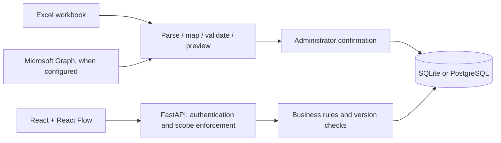

# Architecture and permissions

## Components

`frontend/src/` provides a React SPA. React Flow renders only visible graph nodes, Dagre positions the visible subgraph, and expansion state is independent of the complete authorized dataset. The browser never calculates restricted compensation. `backend/domain.py` owns validation and financial rules; `backend/importer.py` parses workbooks; `backend/db.py` is the SQL persistence adapter; `backend/auth.py` is the identity/role adapter; `backend/app.py` exposes the HTTP and Graph boundaries.

## Relational schema

Tables `employees`, `org_units`, `compensation`, `budgets`, `objectives`, and `key_results` have immutable string primary keys, indexed relational references, and a canonical JSON payload. Foreign keys are deferred to support circular employee/unit ownership and arbitrary insertion order. JSON stores the complete workbook row and provenance; references are also materialized as constrained columns. Compensation keys combine employee ID and effective start date. Business validation rejects overlapping compensation periods, duplicate unit/year/currency budgets, invalid owners, and cycles.

`schema_state` records schema/data versions; `audit_events` stores actor, time, version and change details; `import_versions` stores durable imported snapshots and digest; `import_previews` stores temporary pending plans; `app_settings` stores root selection, sample classification and Graph status. `backend/migrate.py` idempotently initializes v1. Future schema changes require a new explicit migration; `create_all` does not migrate existing columns.

Every mutation compares the expected data version using an atomic conditional SQL update in the same transaction as the record changes, audit, and import snapshot. A stale client receives HTTP 409. Transactions replace the logical dataset as a unit; this keeps rules consistent but is deliberately optimized for the tested scale, not millions of rows. SQL foreign keys and rollback keep failed writes from leaving partial state. SQLite WAL is enabled; production uses PostgreSQL with TLS.

## Roles (enforced on the server)

| Role | Read scope | Compensation | Write permissions |
| --- | --- | --- | --- |
| Administrator | All | Individual and aggregate | Imports, restores, settings, all planning |
| Executive / Finance | All | Individual and aggregate | Units, budget envelopes/allocations, objectives, KRs |
| Department Owner | Explicit unit and descendants | One current USD total for the entire authorized scope, only with at least 5 active employees; no individual pay or nested subtotals | Subdepartments below scope, allocations inside approved envelopes, scoped OKRs/KRs |
| Viewer | Chart, unit headcount/FTE, published objectives | None; no budgets | None |

Company-level objective text and health are visible to owners for alignment, marked read-only. Their company key results and employee owners are not disclosed outside scope. Other out-of-scope objectives remain unavailable. Owner assignment comes from explicit account configuration, never from an employee's manager relationship. The API rejects changing URLs/IDs to access another unit, record or export.

The owner aggregate uses a fixed cohort: one configured root unit including all descendants. The server rejects historical date and alternative currency filters for owners, suppresses groups below five, and never exposes child totals, direct totals, reporting-subtree totals or individual compensation. This avoids simple nested-subtotal subtraction within the app. It is not differential privacy and does not defeat inference from external knowledge or repeated real-world workforce changes. If that risk is unacceptable, grant Viewer instead of aggregate-capable Owner. Payroll money and budget envelopes are separate permissions.

Demo mode is expressly insecure for public deployment: it intentionally lets the user select a role, defaults a fresh local session to Administrator, and labels that choice. Cookies are HttpOnly and SameSite=Strict, signed in memory, and invalidated on restart (falling back to Viewer). `APP_ENV=production` rejects development mode. Entra mode has no dev-session endpoint and validates signed tenant/audience/issuer/expiry claims and an explicit account access map.

Mutation requests with a mismatched Origin are rejected. No secret values are returned to clients, logs, workbook downloads, or configuration examples. Responses use no-store for API data and a restrictive content security policy. Excel uploads reject formulas, duplicate headers/IDs, invalid references and excessively large archives; IDs remain text.

## Operational boundaries

- Files and SQL data persist; application processes and demo login cookies do not survive an environment restart.
- A single worker starts one optional Graph poller. The poller generates review plans only; it never silently applies destructive or conflicting updates.
- Polling refreshes expired/stale previews. A completed Graph import records `lastSuccessfulRefresh`. Network/credential failure preserves the last active dataset.
- Production DB backups restore a whole consistent database during maintenance. User-facing import snapshot restoration is incremental and preserves current app-owned records; it does not delete new records or rewind unrelated planning work.
- Soft deactivation retains historical rows and import versions. There is no hard-delete endpoint.

## Third-party licenses

React, React Flow (`@xyflow/react`), Dagre, Vite, TypeScript, FastAPI, SQLAlchemy, openpyxl, PyJWT, and MSAL use permissive licenses; Lucide uses ISC. Preserve upstream notices distributed with packages. React Flow attribution remains visible. Visual design and initials avatars are original; no OrgPlus branding or assets are copied.
